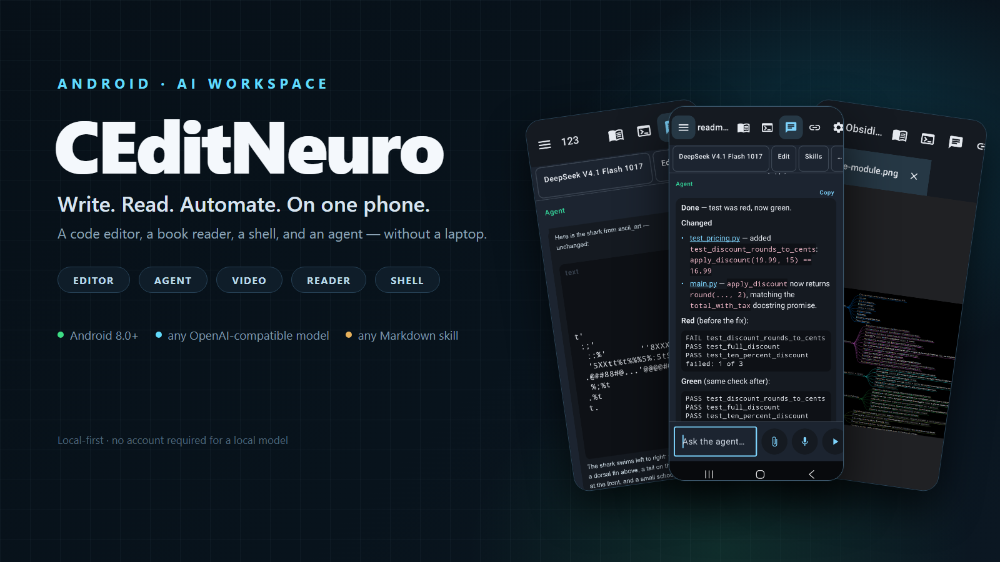
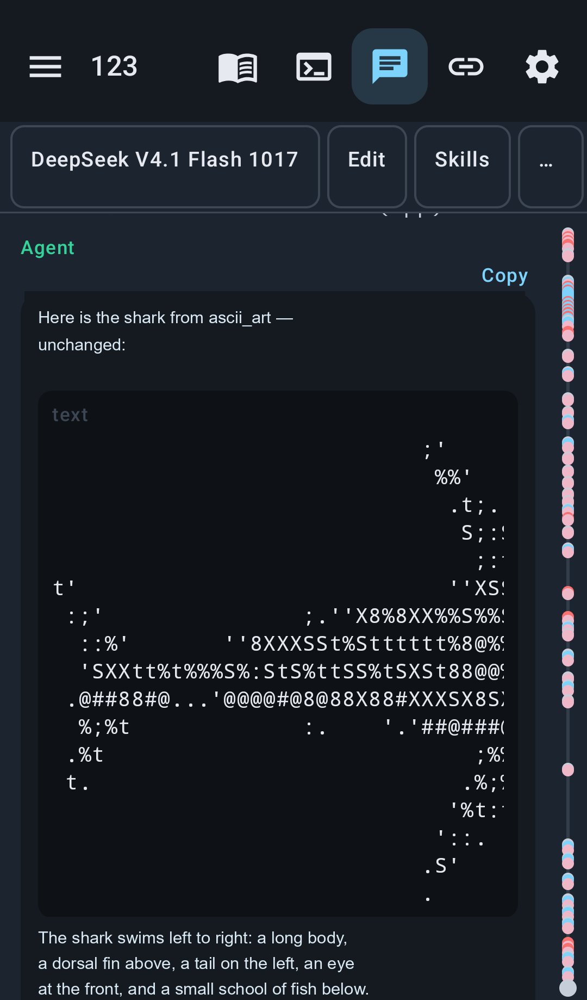
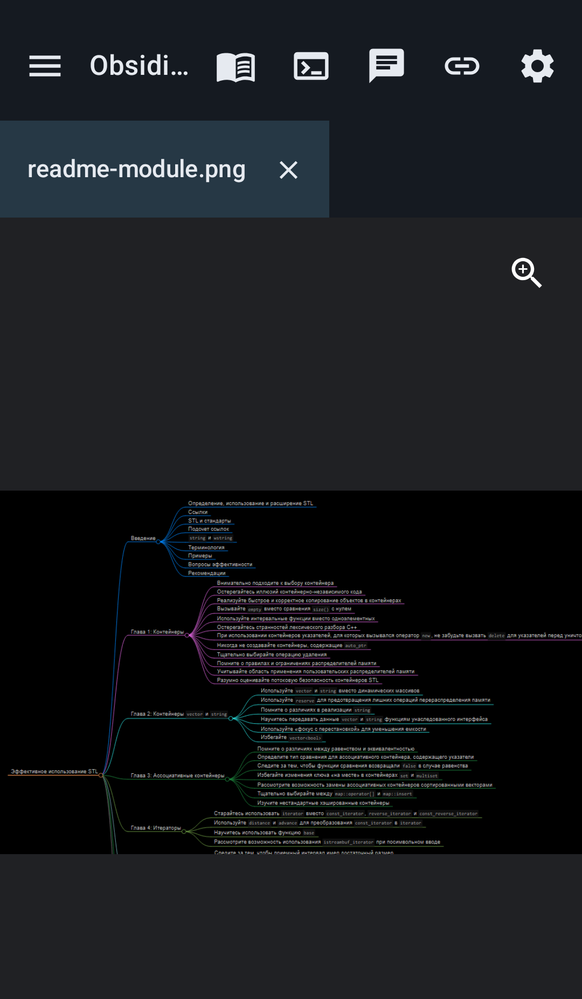
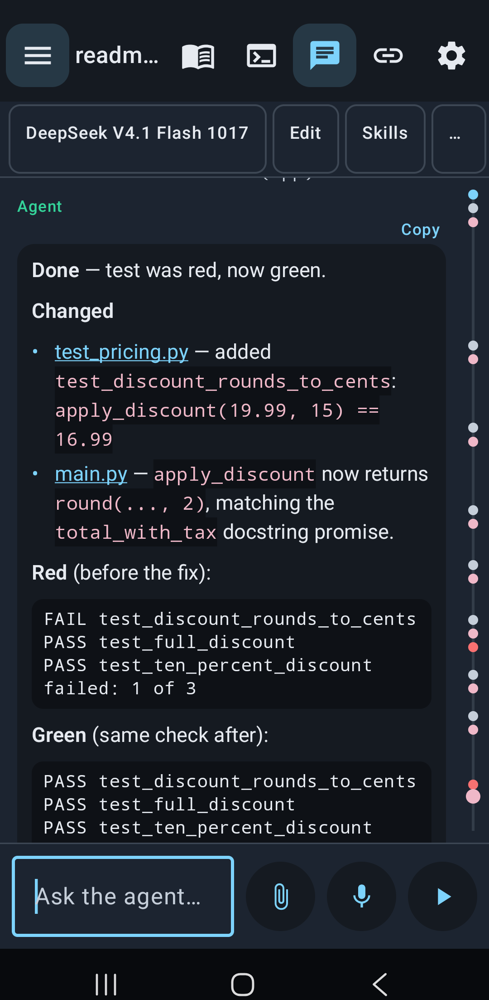
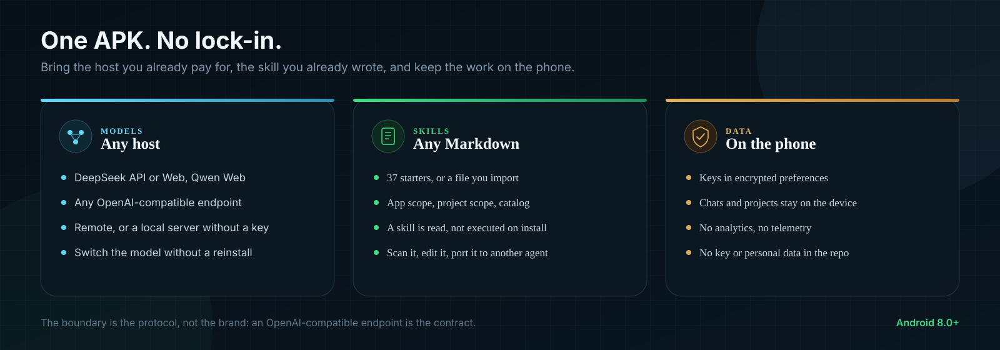

# CEditNeuro

<p align="center">
  
</p>

<p align="center">
  <sub>Real CEditNeuro screens · 123 · Obsidian · demo agent · no personal data · <a href="docs/assets/readme-screen.png">full agent screenshot</a></sub>
</p>

<p align="center">
  <sub>Project screens: <a href="docs/assets/readme-123.png">123</a> · <a href="docs/assets/readme-obsidian.png">Obsidian</a></sub>
</p>

<p align="center">
  <a href="https://github.com/hvkeyn/CEditNeuro/releases/latest"></a>
  <a href="https://github.com/hvkeyn/CEditNeuro/releases/latest"></a>
  <a href="https://github.com/hvkeyn/CEditNeuro"></a>
</p>

Edit a project by hand. Open the agent when you want a change made. Read the report, close the panel, keep editing. The workspace, the tools, and the conversation stay on the device. API keys stay on the device too.

No vendor lock-in: any model exposed through an OpenAI-compatible endpoint, including a local server with no key, and any Markdown skill that fits the contract. A file never grants a permission. Nothing in this repository, its releases, or its starter skills contains an API key, a token, a device ID, or a user's chat.

**[Download the latest APK](https://github.com/hvkeyn/CEditNeuro/releases/latest)** · [All releases](https://github.com/hvkeyn/CEditNeuro/releases)

---

## New in 0.99.37

- **Spec Kit** as a local skill: constitution → spec → plan → tasks → analysis → implementation → convergence. The plan is frozen, every task has a check, and unknown requirements stay marked instead of invented.
- **Visualize** and `visual_card`: process flows, architectures, sequences, timelines, comparisons, exploded views, and technical sheets are drawn as static paper cards in the chat.
- **Animated ASCII**: `ascii_art` can play 2–8 shifted frames as a CSS loop in the card. No GIF encoder is installed; MP4 still goes through `render_video`.
- **A calmer chat**: long reasoning and tool output collapse to one line; scrolling up no longer snaps back while the agent writes; the End control goes to the real bottom of the conversation.
- **Device teardown**: `visualize` draws a static exploded, orthographic, or section sheet for a phone, watch, drive, or other object, and can add a restrained CSS/SMIL animation when movement is the explanation.
- **Looping visuals**: an animated SVG replays after a five-second pause; ASCII frames hold for five seconds after the last frame. Static cards are left alone.
- **Visual intent**: a request to show a process, system, device, or drawing switches on the `visualize` skill before the model starts; the Skills chip confirms it.
- **Your language**: thinking headers and stages follow the language of the request; the visible status no longer appears as an English fragment.
- **Larger sheets**: `visual_card` accepts detailed SVGs up to 18,000 characters, so a system or device drawing is not rejected for being too rich.
- **Evidence-based learning**: a lesson needs a failed action, a command or file, and a fix; one chat is not training. Harness edits still go through rrsi and the Doctor report.
- **Thinking console**: a compact spinner and a stable stage replace flashing fragments; tapping the row opens a numbered, readable step list.
- **Stable sheets**: SVG cards use their `viewBox` for height and no longer grow in pieces while you scroll; ASCII cards reserve their height before the drawing loads.
- **Community files**: contributing, code of conduct, security, accessibility, MIT license, issue forms, and a pull request template are now in the repository.

---

## Why it feels different

Most mobile coding tools are a chat window next to a file list. CEditNeuro is built the other way around: the project is the centre, and the agent is a tool inside it. It reads the files you see, runs the same shell, writes the same report, and then gets out of the way. Close the panel and the editor is still there, with the change already on disk.

> One APK. A code editor, a reader, a shell, and an agent — not a remote desktop, and not another chat box.

## What you can do

| | |
| --- | --- |
| **Edit** | A file tree, tabs, and tree-sitter highlighting for Java, Kotlin, Python, JSON, and XML. Open a Python or shell script and run it without leaving the editor. |
| **Video** | A reel editor for a video already in the project: picture and sound tracks, effects, transitions, and an MP4 rendered on the phone. |
| **Download** | Save a film, a clip, or a stream into the project. Direct MP4, WebM, and MOV resume from a `.part`; HLS with AES-128 is resolved here; a page yt-dlp knows goes through yt-dlp. A browser extension, Android share, or link hands the page to the agent. |
| **Agent** | Tool calling, Markdown skills, project memory, and a Doctor report that finds repeated mistakes. The model is not trained by this app. The agent can edit, run checks, draw a card, or write a motion reel. |
| **Read** | txt, Markdown, HTML, FB2, and EPUB, with pages that fit the screen, notes, bookmarks, contents, and read-aloud. Pictures get their own page. |
| **Phone** | Install an APK, turn a web page into an app, set a timer, and use mail, FTP, or SFTP without a second device. |
| **Study** | A checked research report, a chart or card drawn in the chat, a network audit that matches trails, and notes from a public video page. |

## A closer look

<table>
<tr>
<td align="center" width="33%"><br><sub><b>123</b> · ASCII studio</sub></td>
<td align="center" width="33%"><br><sub><b>Obsidian</b> · C++ map</sub></td>
<td align="center" width="33%"><br><sub><b>Agent</b> · red → green</sub></td>
</tr>
</table>

The screens are the app itself. A project is a folder, a chat belongs to that folder, a skill is one text file, and a model is a host you choose. The loop is deliberately short: pick a folder, edit or ask, run, read the report, keep editing.

DeepSeek is built in, through its API or a sign-in on this phone. The API model is `deepseek-flash`, shown as DeepSeek V4.1 Flash 1017. Settings can fetch the models a host is offering, including another OpenAI-compatible service and a local server with no key. Qwen web chat is the same idea: sign in once inside the app, no key and no computer. Other providers can be added in Settings.

## Any model. Any skill. No lock-in.

This is not a roadmap. A model is a host, a URL, a key, and a model name; a skill is one Markdown file. Neither is baked into the APK.

| | |
| --- | --- |
| **Models** | DeepSeek API or DeepSeek Web, Qwen Web, or any OpenAI-compatible host, remote or local. Paste the base URL, add a key if the host needs one, then fetch its model list or type a model name. A local server such as Ollama or LM Studio can run without a key. Switch the active provider or model without reinstalling and without losing projects. |
| **Skills** | Any Markdown procedure that fits the contract: app scope `CEditNeuro/skills`, project scope `.ceditneuro/skills`, a public catalog, or a file you import. The current source ships 39 starters, but that is a starting set, not a fixed list. A skill adds instructions; it does not add a tool, a permission, or executable code. |
| **Data** | No account is required for a local model. A key is stored on the phone in encrypted preferences and sent only to the host you choose. The app has no analytics or telemetry. Chats and projects stay on the device; only the request you send goes to that model host, and a tool goes to a service only when you call it. |

<p align="center">
  
</p>

The boundary is the protocol, not the brand: a model that speaks an OpenAI-compatible chat endpoint works; a provider with a different protocol needs a gateway or an adapter. The app does not pretend that an arbitrary API is compatible.

- No API key, token, personal chat, or private project path is stored in this repository, its release assets, or its bundled skills.
- The only key is one you paste; it lives in the app's encrypted settings.
- A profile backup under `CEditNeuro/profiles` can contain keys and server passwords, so do not commit it or put it in a release.

A skill is read when it is selected, not executed when it is installed. It can only call a tool that already exists in this build; if the tool or permission is missing, the skill does not create it. Before installing an unknown file, use `scan_skill` / the `skill-security` procedure. The same Markdown files can be copied to another agent; there is no database or compiled bundle to port.

---

## Install

1. Download the APK from [the latest release](https://github.com/hvkeyn/CEditNeuro/releases/latest).
2. Allow install from this source and confirm the system installer.
3. Grant all-files access. The app edits project folders on shared storage, which is why it is sideloaded and not a Play Store app.
4. Tap **Choose folder** and point it at a project.
5. Open **Settings**. Paste a DeepSeek API key, or use **DeepSeek Web** / **Qwen Web** and sign in on the page.

**Check for updates** sits at the bottom of Language models. A newer release asks before it downloads. There is no Play Store account and no sign-up for a local model.

## First five minutes

- The chat icon slides the agent in. The paperclip attaches a photo or a file; the book and terminal icons open the reader and the shell.
- Long-press a file for **Read**, notes, sharing, renaming, or deleting it.
- **Doctor** reads saved sessions and lists mistakes that repeat, including the same miss in chats and texts. The report keeps the kind of miss, not the sentence.
- Long project and skill menus stay on screen and scroll.
- Opening another project does not stop the agent you left running.
- The menu button hides the project list so the file list can use the height.

## Build

JDK 17 and Android SDK 35.

```sh
echo "sdk.dir=/path/to/Android/Sdk" > local.properties
./gradlew assembleRelease
```

The release APK is in `app/build/outputs/apk/release/`. Most of its size is the tree-sitter libraries and JGit.

## What stays on the phone

Settings, the API key, saved servers, and each project's chat are copied to `CEditNeuro/profiles` on shared storage. Uninstalling the app deletes its private files. The next install loads that profile after all-files access is allowed.

That folder contains the API key and server passwords. Do not copy it into a repository or a public release.

The repository and the release APK contain no API key, token, device ID, or user chat. The app has no analytics or telemetry. A request goes only to the model host selected in Settings; a tool goes to a network service only when that tool is called. There is no account requirement for a local model.

## Shell

`run_command` is mksh and toybox inside this app. It is not Termux: there is no `pkg` or `apt`. Git status and diff go through JGit. A JDK, the Android SDK tools, and other runtimes can be unpacked into this app's toolchain from the Termux mirror.

An absolute path is a real directory on this phone. `HOME` is this app's private directory. `DOWNLOAD` is the public Downloads folder.

## Video

Open a video and tap **Edit**. The reel keeps picture tracks and sound tracks in one file next to the video — no project-wide timeline to configure, no second app.

- Drag a block along its track, or onto another picture or sound track. An empty track at the edge takes a block onto a new layer.
- Effects: fade, gray, warm, zoom, mute, blur, and flip. Transitions: hard cut, dissolve, wipe, and dip to black.
- A layer starts at its first frame and fades in. It does not pop on, and it does not cover a layer that is still in the shot.
- While a reel gathers pictures and sound, it searches one Scrolltide template and keeps only the motion that page printed. The catalog is not stored.
- **Save** keeps the reel; **Render** encodes an MP4 in the project. The phone's own encoder also shrinks an existing jpg, png, webp, or mp4.

## Download

Ask the agent for a film or a clip, paste a video page, or send the page from the browser extension. `download_video` saves it under `downloads/` in the project, then the video tab opens it and the reel editor can cut it.

- A direct MP4, WebM, or MOV is streamed to disk and resumes from its `.part`.
- An HLS playlist is resolved on the phone, including AES-128 segments. An MPEG-TS result is remuxed to MP4 with the phone's own extractor, so it plays here.
- A page yt-dlp knows goes through yt-dlp. The first such page may install Python and yt-dlp into the app's toolchain; this happens on the phone and does not install a second app.
- A DRM-protected, paid, or login-only video is refused. The app does not bypass DRM or log in for the user.
- A site that offers only separate picture and sound tracks is refused when yt-dlp is the engine. An HLS master with a separate audio group saves the picture track and says so; the phone has no ffmpeg to join them.

**[Browser extension](tools/extension)** · The popup sends the current tab to the phone. It calls the app on `127.0.0.1:27100–27120` and needs the token from `/token`. The app also listens for a `vidbee://download?url=` link and for the Android share sheet, so the VidBee extension and any browser can hand off a page. The bridge is loopback-only, and a request from a web page is refused.

## Skills

The agent loads Markdown procedures from `CEditNeuro/skills` on this phone and from `.ceditneuro/skills` in the project. It can also search a public catalog, check a downloaded file, and save only the adapted procedure. **[SKILLS.md](SKILLS.md)** is the complete catalog: all 39 skills, their triggers and tools, the file contract, the activation path, and how to move one to another agent.

One of the 39 is **`spec-kit`**: it writes a constitution, a specification, a plan, and a task list, freezes the plan, and refuses code before the analysis gate. Every task has an ID, a file path, a check, and a status; a plan change is explicit and approved. It is a local Markdown adaptation of GitHub's Spec Kit, not its CLI.

Another is **`visualize`**: quick ASCII, or a static SVG for process flows, architecture, sequences, timelines, comparisons, exploded views, sections, orthographic sheets, and layered concepts.

ASCII frames can loop in the chat (CSS); the same skill also allows a restrained CSS/SMIL motion in an SVG when movement is the explanation. Actual GIF or MP4 files still need an existing renderer; the app does not install one. `visual_card` draws it on a paper card in the chat; the SVG is the source, and PNG/PDF are produced only when a renderer already exists.

The 39 starters are a starting set, not a closed list. Any other Markdown procedure that follows the same contract can be copied into either scope, imported from the catalog, or pasted in as a file.

- A skill is read only when it is selected; installing it does not run it and does not grant a tool or a permission.
- If a skill names a tool this build does not have, the skill does not create it. The agent says what is missing instead of pretending.
- The files are portable: the same text works in another agent with its own tool names. There is no database or compiled bundle to port.

## Reading

Long-press a file and choose **Read**, or tap the book icon.

- txt, Markdown, HTML, FB2, and EPUB are paginated to the screen.
- Pictures inside FB2, EPUB, and HTML get their own page. **Pen**, **Notes**, **Contents**, and **Book** stay with that file.
- PNG, JPG, WebP, GIF, BMP, SVG, and HTML also open as a preview, with a switch back to the text.
- On a phone, the page is the unit: no horizontal scrolling to find the next paragraph.

## Contributing

- [Contributing guide](CONTRIBUTING.md) — build, tests, and the pull request checklist.
- [Code of conduct](CODE_OF_CONDUCT.md) — the standard for every project space.
- [Security policy](SECURITY.md) — report privately; do not post a key or a working exploit.
- [Accessibility](ACCESSIBILITY.md) — what is supported, known limits, and how to report a barrier.
- [MIT license](LICENSE) — the project is open source.

## Layout

```
app/src/main/java/com/hvkeyn/ceditneuro/
  agent/        loop, prompts, skills
  data/         settings and the API key
  shell/        mksh and toybox
  tools/        what the agent can call
  ui/           Compose screens
  workspace/    project root and path rules
```

Design notes live in [`docs/ARCHITECTURE.md`](docs/ARCHITECTURE.md).

---

**Ready to try it?** [Download the latest APK](https://github.com/hvkeyn/CEditNeuro/releases/latest), point it at a folder, and open the agent. The first change is a few taps away.
